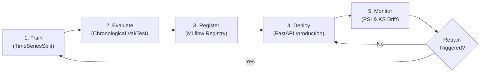

# Model Lifecycle Guide

This document describes the end-to-end MLOps lifecycle for the AQI prediction system:
`Train → Evaluate → Register → Deploy → Monitor → Retrain`

---

## 1. Train (`src/ml/train.py`)
- **Feature Extraction**: Daily lag, rolling, and cyclical features generated deterministically by `src/ml/features.py`.
- **Chronological Splitting**: 70% Train, 15% Validation, 15% Test strictly split by date to prevent future lookahead leakage.
- **Cross-Validation**: 4-split `TimeSeriesSplit` on training data only for hyperparameter tuning.
- **Model Candidates**:
  - Regression: Persistence baseline, 7-day Moving Average, Ridge, Random Forest Regressor, XGBoost Regressor.
  - Classification: Logistic Regression, Random Forest Classifier, XGBoost Classifier.
- **Reproducibility**: Random seed pinned to `42` (`RANDOM_SEED`).

---

## 2. Evaluate (`src/ml/evaluate.py`)
- **Regression Metrics**: Root Mean Squared Error (RMSE), Mean Absolute Error (MAE), Coefficient of Determination ($R^2$).
- **Classification Metrics**: Accuracy, Precision, Recall, Macro-F1, Confusion Matrix.
- **Artifacts**: Evaluation summaries saved to `reports/model_comparison.csv` and `reports/model_comparison.md`. Residual plots, predicted vs. actual curves, and confusion matrix charts saved to `reports/figures/`.
- **Experiment Tracking**: All metrics, parameters, and figures logged to MLflow experiments:
  - `aqi-regression`
  - `aqi-classification`

---

## 3. Register (`src/ml/register_best.py`)
- **Selection Criteria**: Best model selected by performance on the validation set (`val_rmse` minimized for regression; `val_macro_f1` maximized for classification).
- **Registry Registration**: Model registered under names:
  - `aqi_regressor`
  - `aqi_classifier`
- **Promotion**: If the new candidate outperforms the currently active production model (or if no production model exists), the candidate is assigned the MLflow alias `production`.

---

## 4. Deploy (`src/api/main.py`)
- **FastAPI Inference Service**:
  - Loads models dynamically from MLflow Model Registry via alias `production` at startup.
  - Endpoints:
    - `GET /health`: Operational status and model version verification.
    - `GET /model-info`: Active model names, versions, and feature schema.
    - `POST /predict`: Generates next-day predictions and AQI categories.
    - `GET /metrics`: Service operational telemetry (request count, latency p50/p95, error rate).
- **Audit Logging**: Every incoming request and model response is logged to PostgreSQL table `ml.prediction_log`.

---

## 5. Monitor (`src/monitoring/monitor.py`)
- **Data Quality**: Checks missing rate, out-of-range sensor readings, and data staleness.
- **Feature Drift**:
  - Compares production/inference window against training baseline.
  - Population Stability Index (PSI): threshold > 0.2 flags moderate/significant drift.
  - Kolmogorov-Smirnov (KS) 2-sample test: $p$-value < 0.05 flags statistical distributional divergence.
- **Ground Truth Evaluation**: Evaluates predictions against actual recorded AQI once observations arrive, recording rolling RMSE and MAE in `ml.monitoring_metrics`.

---

## 6. Retrain Loop (`src/monitoring/retrain_trigger.py` & `dags/aqi_ml_pipeline.py`)
Retraining is triggered if ANY of the following rules are met:
1. **Feature Drift**: $\ge 3$ features exceed drift thresholds (PSI > 0.2 or KS $p < 0.05$).
2. **Performance Degradation**: Rolling RMSE degrades by $>20\%$ compared to baseline test RMSE.
3. **Data Quality Issues**: Feature missing rate exceeds $20\%$.
4. **Cadence Schedule**: More than 30 days have elapsed since the last training run.

When triggered, the Airflow ML DAG (`aqi_ml_pipeline`) executes data backfill/refresh, feature extraction, model retraining, and conditional promotion only if validation performance improves.
