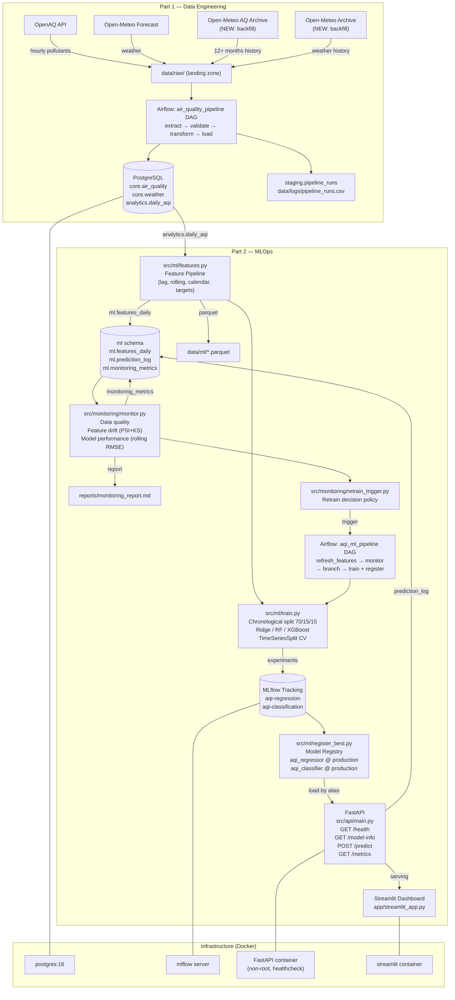

# Part 2 Architecture — MLOps Layer

## Overview

Part 2 extends the Part 1 data engineering pipeline with a complete MLOps system:
feature engineering → experiment tracking → model registry → inference API →
monitoring → automated retraining.

## Architecture Diagram



## Key Design Decisions

| Decision | Rationale |
|---|---|
| Chronological split only | Time series: random split leaks future into training |
| Shift(n) for lags, closed='left' for rolling | Guarantees no look-ahead at features or rolling stats |
| Same features.py at training and inference | One code path → no train-serve skew |
| MLflow alias 'production', not file path | Model version changes without code changes |
| Separate requirements-ml.txt | Airflow and ML packages have conflicting pins |
| Non-root Docker user | Limits blast radius of container escape |
| PSI + KS for drift | PSI for magnitude, KS for shape — complementary signals |

## File Map

```
src/
├── config.py                  # all settings (Part 1 + Part 2)
├── ingestion/
│   ├── backfill_history.py    # Step 1: historical AQ + weather backfill
│   ├── openaq_api.py          # Part 1: current measurements
│   └── weather_api.py         # Part 1: current weather
├── ml/
│   ├── features.py            # Step 2: feature pipeline (lag, rolling, calendar)
│   ├── train.py               # Step 3: training (chronological split, CV, baselines)
│   ├── evaluate.py            # Step 3: metrics, plots, comparison table
│   └── register_best.py       # Step 4: MLflow model registration + promotion gate
├── api/
│   └── main.py                # Step 5: FastAPI service
└── monitoring/
    ├── monitor.py             # Step 7: data quality + drift + performance
    └── retrain_trigger.py     # Step 7: retrain policy

dags/
├── air_quality_pipeline.py    # Part 1: daily data ingestion (unchanged)
└── aqi_ml_pipeline.py         # Step 8: ML pipeline with conditional retraining

app/
└── streamlit_app.py           # Step 9: 5-page dashboard

sql/
├── schemas.sql                # Part 1: schemas
├── tables.sql                 # Part 1: core tables
├── analytics.sql              # Part 1: gold layer
└── ml_schema.sql              # Part 2: ml schema (features_daily, prediction_log, monitoring_metrics)
```
